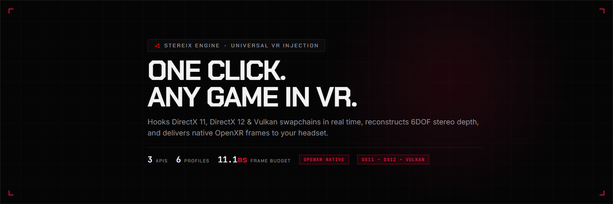
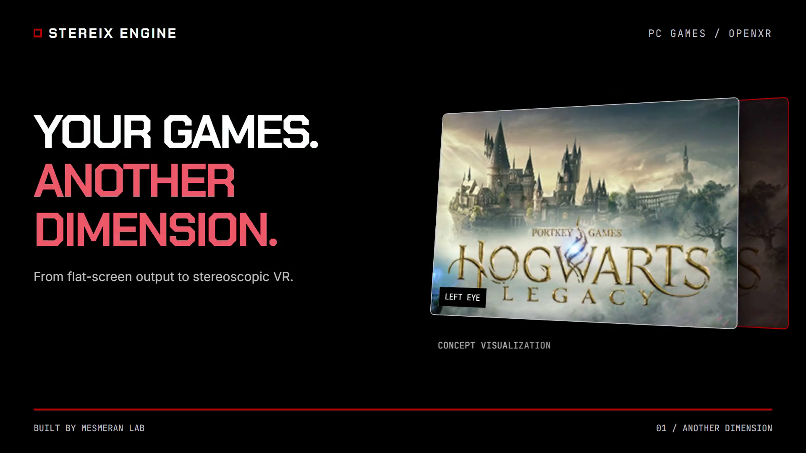
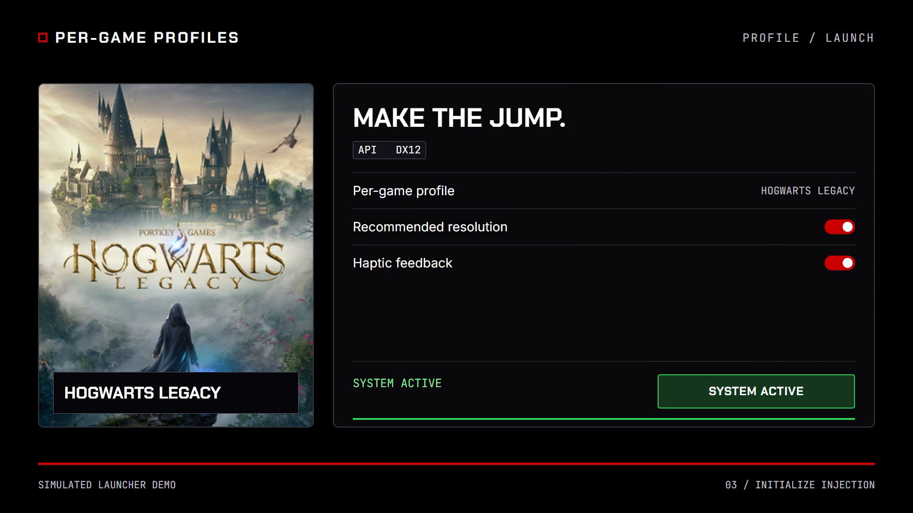

<p align="center">
  <a href="https://stereix-engine.pages.dev">
    
  </a>
</p>

<p align="center">
  <a href="https://stereix-engine.pages.dev"></a>
  <a href="https://stereix-engine.pages.dev"></a>
  <a href="https://stereix-engine.pages.dev"></a>
  <a href="https://stereix-engine.pages.dev"></a>
  <a href="https://discord.gg/FBeGjgK2fd"></a>
</p>

<p align="center">
  <b>Play your flat PC games in true 6DOF virtual reality with one click.</b><br>
  Stereix Engine safely intercepts native graphics swapchains in live memory, extracts in-game camera matrices and scene depth, and reprojects real-time stereoscopic pairs directly into any OpenXR headset — with sub-1.5ms overhead and zero game file modification.
</p>

<p align="center">
  <a href="https://stereix-engine.pages.dev"><b>Explore Documentation & Download</b></a> ·
  <a href="https://stereix-engine.pages.dev/updates/manifest.json"><b>OTA Distribution Manifest</b></a> ·
  <a href="https://discord.gg/FBeGjgK2fd"><b>Community Discord</b></a>
</p>

---

## ⚡ Architecture Overview: Six Stages, One Frame

At 90 Hz, every frame has an 11.1ms total deadline. Stereix operates within a strict **sub-1.5ms render-thread budget**, executing entirely in RAM before the game's presentation call returns.

```text
 ┌───────────────────────────────────────────────────────────────────────────────────┐
 │                                GAME RENDER LOOP                                   │
 └────────────────────────────────────────┬──────────────────────────────────────────┘
                                          │
                                          ▼
 ┌───────────────────────┐    ┌───────────────────────┐    ┌───────────────────────┐
 │  STAGE 1: INTERCEPT   │───►│  STAGE 2: ACQUIRE     │───►│  STAGE 3: CAMERA LOCK │
 │  MinHook Detour       │    │  Swapchain Backbuffer │    │  Heuristic Matrix     │
 │  Present() / Queue    │    │  Epoch Validated      │    │  Scoring & Basis Sync │
 └───────────────────────┘    └───────────────────────┘    └───────────────────────┘
                                                                       │
                                                                       ▼
 ┌───────────────────────┐    ┌───────────────────────┐    ┌───────────────────────┐
 │  STAGE 6: SUBMISSION  │◄───│  STAGE 5: REPROJECT   │◄───│  STAGE 4: DEPTH PASS  │
 │  Native OpenXR 6DOF   │    │  Compute Shaders Warping│    │  Hardware Depth Buffer│
 │  SteamVR / Quest / WMR│    │  Disocclusion Inpaint │    │  Linearized 3D Volume │
 └───────────────────────┘    └───────────────────────┘    └───────────────────────┘
                                          │
                                          ▼
 ┌───────────────────────────────────────────────────────────────────────────────────┐
 │                             IMMERSIVE HEADSET DISPLAY                             │
 └───────────────────────────────────────────────────────────────────────────────────┘
```

---

## 📸 Real-Time Visual Pipeline

<p align="center">
  
  &nbsp;
  
</p>

---

## 🚀 Key Capabilities

| Capability | Technical Implementation |
| :--- | :--- |
| **Universal API Detour** | Hooks DirectX 11, DirectX 12, and Vulkan command queues without engine-specific wrappers |
| **Camera Heuristic Engine** | Auto-detects in-game projection and view matrices via constant buffer candidate scoring |
| **Hardware Depth Extraction** | Captures genuine scene depth to give objects accurate physical volume and convergence |
| **Compute Disocclusion Fill** | Neural and spatial inpainting compute shaders eliminate silhouette tearing along occlusion boundaries |
| **Peripheral Vignette Guard** | Dynamic peripheral motion dampening shaders actively counter VR simulation sickness |
| **In-Headset ImGui Overlay** | Summonable live menu (`L3+R3` / Controller Menu) to tweak IPD, convergence, and depth in real time |
| **100% In-Memory Lifecycle** | Operates strictly in RAM. Zero DLLs installed into game directories; zero game files patched |

---

## 🛡️ Anti-Cheat & Security Posture

Stereix Engine is engineered **strictly for single-player titles and offline gameplay**.

```text
  TIER 1 ── Single-Player / DRM-Free / Unprotected ─────► 100% Safe to Inject & Play
  TIER 2 ── Offline Mode / EAC Disabled (e.g. Elden Ring) ► Supported Offline Only
  TIER 3 ── Active Online Multiplayer / Kernel Anti-Cheat ─► AUTOMATICALLY BLOCKED
```

> [!CAUTION]
> **Account Ban Protection**: Injecting into multiplayer titles with active anti-cheat (Easy Anti-Cheat, BattlEye, Vanguard, Ricochet) will trigger bans. Stereix Engine detects anti-cheat systems prior to memory attachment and **refuses to inject**. Stereix will never incorporate bypasses for active anti-cheat.

---

## 🎮 Shipped & Verified Game Profiles

Stereix includes tested zero-configuration profiles in `profiles/`:
- **Cyberpunk 2077** (`DX12` · REDengine 4)
- **Hogwarts Legacy** (`DX12` · Unreal Engine 4)
- **Elden Ring** (`DX12` · FromSoftware · Offline Mode)
- **Palworld** (`DX12` · Unreal Engine 5)
- **Sekiro: Shadows Die Twice** (`DX11` · FromSoftware)
- **Mortal Shell** (`DX11` · Unreal Engine 4)

### Creating Custom Profiles in 3 Minutes
Profiles are human-readable JSON files. No C++ compilation or reverse engineering required:
```json
{
  "name": "Custom Title",
  "engine": "Unreal Engine 5",
  "api": "DX12",
  "reverseZ": true,
  "rowMajor": true,
  "srgb": true,
  "depth": true
}
```
Drop your profile into `profiles/` and the launcher detects it automatically on attach.

---

## 🏛️ Monorepo Structure

```text
Stereix-Engine/
├── stereix-client/         # Native C++ Engine, OpenXR Layer & Desktop Launcher
│   ├── src/core/           # Runtime state orchestration & memory lifecycle
│   ├── src/hooks/          # MinHook detours for DX11, DX12, and Vulkan
│   ├── src/rendering/      # GPU compute shaders, swapchains, and OpenXR submitter
│   ├── shaders/            # HLSL/SPIR-V stereo warp and reprojection compute shaders
│   └── launcher/           # Electron / React desktop application
├── stereix-backend/        # Cloud services platform (Node.js/TypeScript, Prisma, Redis)
├── stereix-infrastructure/ # Production cloud infrastructure (Terraform, AWS, Cloudflare)
├── stereix-docs/           # Landing page, architecture playbooks, and documentation
│   └── landing-page/       # Production web client hosted at stereix-engine.pages.dev
└── updates/                # Digitally signed OTA binaries and Ed25519 manifest
```

---

## 🛠️ Quick Start & Build Instructions

### Prerequisites
- **OS**: Windows 10/11 x64
- **Toolchain**: Visual Studio 2022+ (C++ x64 CMake Tools)
- **Runtimes**: Vulkan SDK, Node.js 20+

### 1. Build the C++ Engine
```powershell
# Configure and build native release binaries
cmake -B build -S . -A x64
cmake --build build --config Release --target vrinject vr-inject-cli
```
All binaries will land in `build/bin/` (`vrinject.dll`, `vr-inject-cli.exe`).

### 2. Run the Desktop Launcher
```bash
cd stereix-client/launcher
npm install
npm run dev
```

### 3. Run Static Verification Tests
```bash
cd stereix-client/launcher
npm run test:ci
```

---

## 📄 License & Enterprise Partnership

This project is released under the [Proprietary Software License Agreement](LICENSE). All rights reserved.  
For enterprise OEM licensing, custom engine integrations, and studio partnerships, contact **Mesmeran Lab** via [Discord](https://discord.gg/FBeGjgK2fd) or email.

---

<p align="center">
  <sub>Architected with precision by <b>sathishssj3</b> & the Stereix Engine contributors.</sub>
</p>
